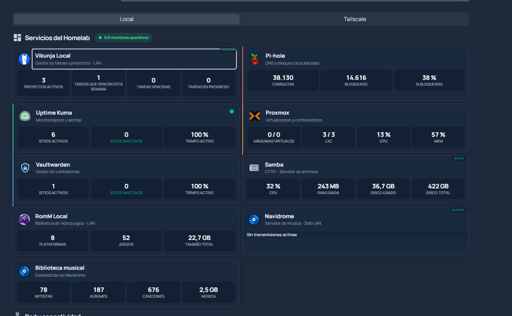
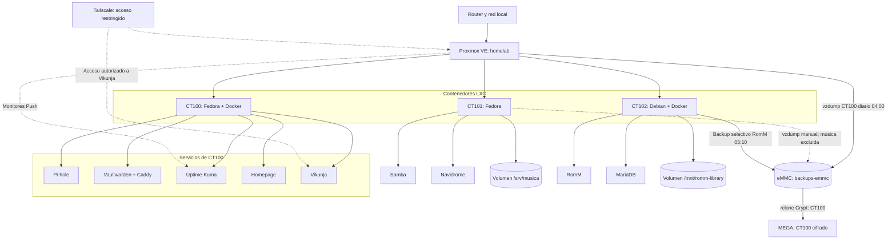

# Mi Homelab — Proxmox, Docker y copias de seguridad cifradas



> **Proyecto documentado desde el 15/10/2026 y actualizado el 28/10/2026.** Documentación de un homelab **realmente configurado**, no un tutorial ficticio de instalación. Los ejemplos son versiones publicables y **no contienen credenciales reales**. No ejecutar los scripts del repositorio a ciegas: hay que comprobar rutas, IDs, permisos y nombres de remotos.

## Visión general

Homelab con **Proxmox VE** instalado en un equipo compacto y tres contenedores LXC en funcionamiento. El host utiliza un disco **Toshiba USB de 1 TB** con almacenamiento LVM-thin y una **eMMC interna (58 GiB útiles)** para copias locales. **Homepage** presenta los servicios y sus métricas en las pestañas *Local* y *Tailscale*; **Uptime Kuma** supervisa su disponibilidad y recibe comprobaciones Push.

| Capa | Componente | Función |
| --- | --- | --- |
| Virtualización | Proxmox VE | Host, LXC, LVM-thin y copias `vzdump` |
| Servicios principales | CT100 (Fedora + Docker) | Pi-hole 6, Vaultwarden + Caddy, Uptime Kuma, Homepage y Vikunja |
| Ficheros y música | CT101 (Fedora) | Samba y Navidrome; volumen musical independiente |
| Videojuegos | CT102 (Debian + Docker) | RomM y MariaDB; biblioteca ROMs en volumen independiente |
| Panel | Homepage | Vista Local/Tailscale y tarjetas con estadísticas de cada servicio |
| Monitorización | Uptime Kuma + systemd | Servicios, eMMC, memoria/swap, LXC y backup de RomM; avisos Telegram |
| Backup local | eMMC `backups-emmc` | CT100 diario, CT101 mediante copias manuales y datos selectivos de RomM |
| Backup remoto | Rclone Crypt + MEGA | Copia externa cifrada de CT100; **no** de toda la biblioteca de música o ROMs |

### Topología actual (28/10/2026)



**Alcance de las copias:** el backup selectivo de RomM protege MariaDB, configuración, assets y recursos, pero **no** los juegos del volumen de biblioteca. El backup de CT101 excluye `/srv/musica`; el envío cifrado a MEGA documentado corresponde a CT100. Las rutas y los servicios se basan en la configuración observada; las métricas del panel son una instantánea.

> **Importante:** el fichero JSON de Homepage muestra estadísticas, **no sustituye a una verificación independiente del backup**. El panel de MEGA no necesita ni debe recibir credenciales de Rclone.

## Resultado verificado

- Backup programado a las **04:00** de CT100 (modo **stop**, compresión **ZSTD**, retención **3**).
- eMMC interna de **58,2 GiB** montada en `/mnt/backups` y registrada como almacenamiento `backups-emmc`, con protección de punto de montaje.
- Copia del **15/10/2026 04:00:26**: **2.040.816.868 bytes**, visible en eMMC y MEGA.
- Subida externa automática iniciada a las **04:07:37** y confirmada a las **04:15:52**.
- Restauración de prueba a **CT101** completada **sin arrancarlo ni conectarlo a la red**; directorios persistentes presentes. CT101 se retiró tras la comprobación.
- Prueba de lectura remota `rclone cat ... | zstd -t -` completada correctamente para la primera copia. **No equivale a una restauración funcional de todos los servicios**.
- Monitor Push de backups en Uptime Kuma y resumen JSON en Homepage funcionando.

## Índice de documentación

| Documento | Contenido |
| --- | --- |
| [01 · Arquitectura](docs/01-arquitectura.md) | Host, hardware, discos, red y dependencias |
| [02 · Proxmox y CT100](docs/02-proxmox-ct100.md) | Configuración conocida y verificaciones |
| [03 · Servicios Docker](docs/03-servicios.md) | Pi-hole, Vaultwarden, Kuma, Homepage y Caddy |
| [04 · Homepage](docs/04-homepage.md) | Panel, API, CSS, JS, JSON interno |
| [05 · Backup local](docs/05-backup-local.md) | Preparación eMMC, fstab, retención y job |
| [06 · MEGA cifrado](docs/06-mega-rclone.md) | Rclone, Crypt, script, hook y sincronización del dashboard |
| [07 · Monitorización](docs/07-monitorizacion.md) | Estado, Push y Telegram |
| [08 · Restauración](docs/08-restauracion.md) | Restauración local y desde MEGA, seguridad |
| [09 · Incidencias](docs/09-incidencias.md) | Problemas diagnosticados y solución aplicada |
| [10 · Mantenimiento](docs/10-mantenimiento.md) | Pruebas, espacio, actualizaciones y checklist |
| [11 · Historial](docs/11-historial.md) | Cronología del despliegue |
| [12 · Límites pendientes](docs/12-pendientes.md) | Qué está verificado y qué no |
| [13 · GitHub y seguridad](docs/13-publicacion.md) | Cómo publicar sin filtrar secretos |

## Archivos de referencia

- [`ejemplos/homepage/compose.yaml`](ejemplos/homepage/compose.yaml): Homepage + servidor Nginx interno de estadísticas.
- [`ejemplos/homepage/config/`](ejemplos/homepage/config/): configuraciones de ejemplo, con tokens referenciados por variables.
- [`ejemplos/proxmox/fstab-backups.example`](ejemplos/proxmox/fstab-backups.example): montaje permanente de eMMC.
- [`scripts/backup-mega.sh`](scripts/backup-mega.sh): copia cifrada y limpieza de remotos.
- [`scripts/vzdump-mega-hook.sh`](scripts/vzdump-mega-hook.sh): arranque independiente al completar un backup.
- [`scripts/actualizar-homepage-mega.py`](scripts/actualizar-homepage-mega.py): resumen JSON sin credenciales.
- [`ejemplos/backup-mega-kuma.curl.example`](ejemplos/backup-mega-kuma.curl.example): formato de configuración Push (sin token).

Estos ejemplos reflejan la estructura desplegada; **no se han extraído los ficheros reales del servidor**. Pueden existir diferencias respecto a los archivos locales, especialmente en `services.yaml`, estilos y Compose de aplicaciones cuyos archivos no se compartieron íntegramente.

## Inicio rápido (lectura, no instalación)

En el **host Proxmox**:

```bash
pct status 100
pvesm status
pvesh get /cluster/backup --output-format json-pretty
pvesm list backups-emmc --content backup
rclone ls mega-crypt:CT100
journalctl -u 'backup-mega-ct100-*' --since 'today 04:00' --no-pager
```

En **CT100**:

```bash
docker ps
cd /root/homepage
docker compose ps
```

**No subir al repositorio** los archivos `.env`, `rclone.conf`, la URL Push de Kuma ni copias de bases de datos. Ver [publicación segura](docs/13-publicacion.md).

## Fuentes oficiales

- [Proxmox `vzdump` y scripts de hooks](https://github.com/proxmox/pve-docs/blob/master/vzdump.adoc)
- [Ejemplo oficial de hooks de `vzdump`](https://github.com/proxmox/pve-manager/blob/master/vzdump-hook-script.pl)
- [Rclone: MEGA](https://rclone.org/mega/)
- [Rclone: Crypt](https://rclone.org/crypt/)
- [Homepage: Custom API](https://gethomepage.dev/widgets/services/customapi/)
- [Homepage: configuración](https://gethomepage.dev/configs/settings/)

**Licencia:** sin licencia asignada por ahora. Añade una licencia apropiada si deseas permitir la reutilización explícita de los archivos.

<!-- actualizacion-homelab-2026-10-28 -->
## Actualización de octubre de 2026

Se han documentado las mejoras del homelab en cinco capítulos adicionales:

- [14. Vikunja: usuarios y alertas de Telegram](docs/14-vikunja-telegram.md)
- [15. Monitorización con Uptime Kuma y systemd](docs/15-monitorizacion-avanzada.md)
- [16. Backups selectivos de RomM](docs/16-backups-romm.md)
- [17. Seguridad y aislamiento con Tailscale](docs/17-seguridad-tailscale.md)
- [18. Inventario, backups y pendientes](docs/18-estado-y-pendientes.md)

[Resumen y archivos de la actualización](README-ACTUALIZACION.md) · [Cambios del 28/10/2026](docs/actualizacion-2026-10-28.md)
